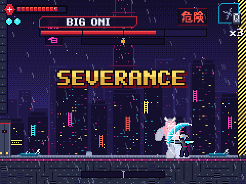
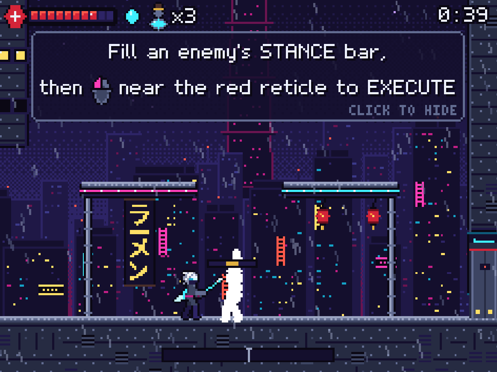
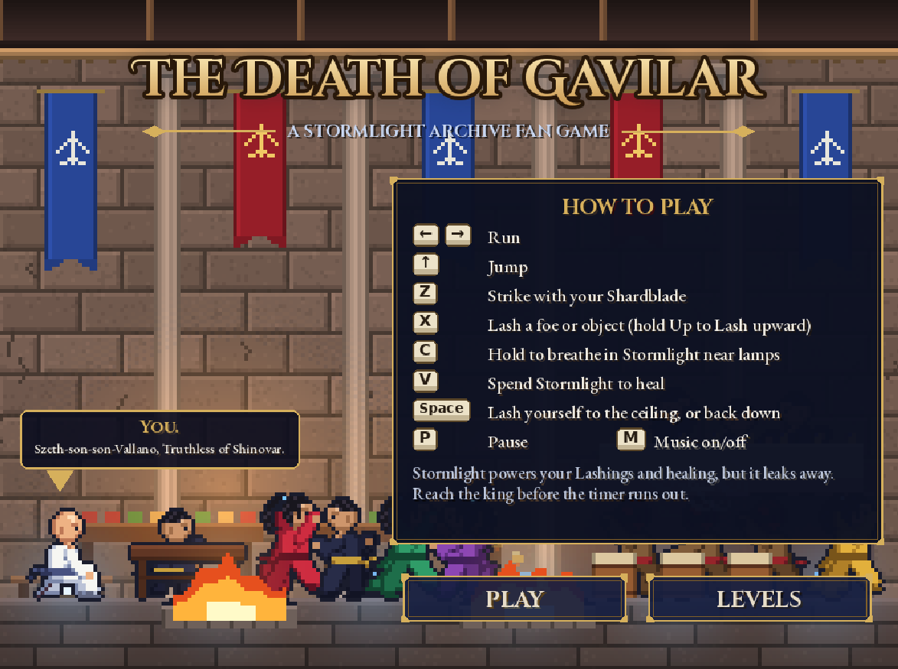
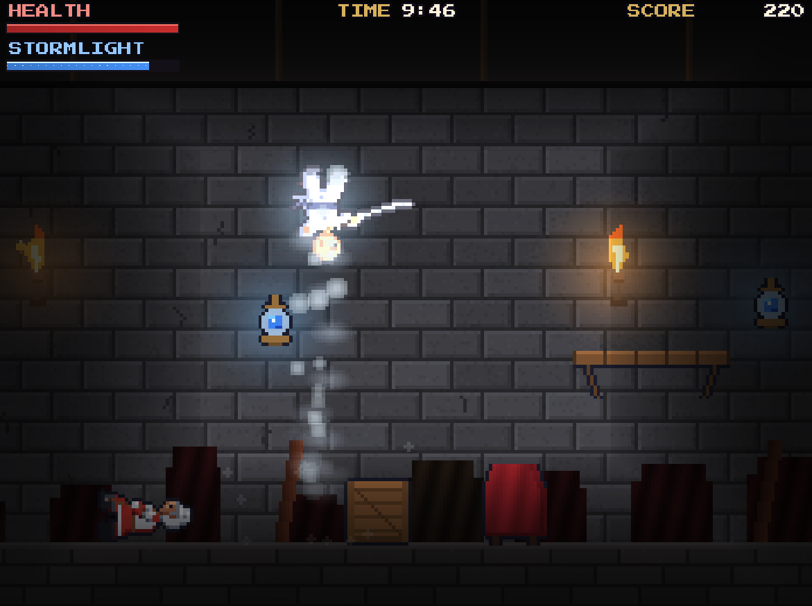
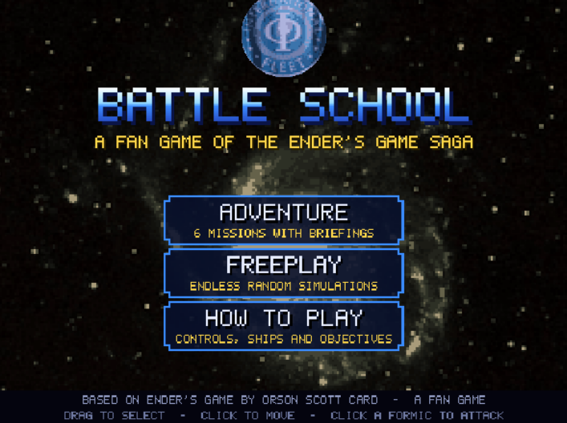
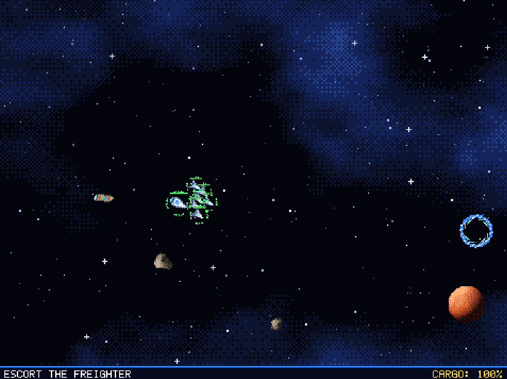
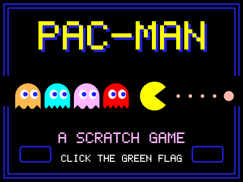
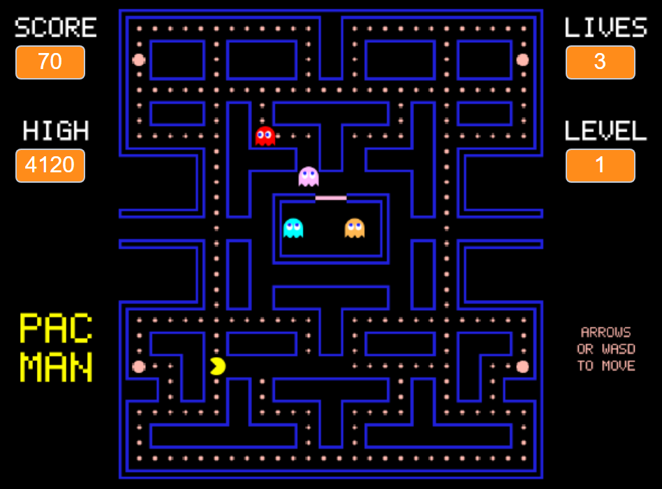
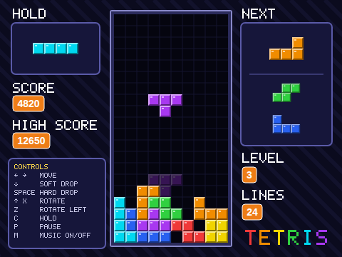

# Scratch Games

A collection of games built in Scratch. Each folder holds a project file you can load into the Scratch editor, plus a README with instructions, controls and credits.
See these games in action on my [Scratch profile](https://scratch.mit.edu/users/thebslee/)

## Cyberpunk Ninja

      

A ninja action platformer set in a futuristic sci-fi city. You play as Hotaru, a young woman who wakes in the slums with no memories and a ghost in her head; your goal is to fight your way up to the Kanshi Spire. The platforming takes after Celeste and the deflect-and-stance combat after Sekiro, spread across 8 chapters of story and boss fights. The `.sb3` is generated rather than hand-edited: a Python build compiles the game logic to Scratch blocks, renders the rooms, synthesizes the audio, and packs it all into a project. Headless playtests run the game in scratch-vm under Playwright.

## Stormlight Archives: The Death of Gavilar

A fan game based on the prologue of Brandon Sanderson's *The Way of Kings*. Play as Szeth and fight through the palace to reach King Gavilar before a 10-minute timer runs out.

## Ender's Game: Battle School

A real-time strategy game set in the Battle School simulator from *Ender's Game*. Drag-select fighters, cruisers and dreadnoughts, use asteroids for cover, and wipe out the Formic fleet. Play six pre-designed Adventure missions, or Freeplay, where random battles get harder as you go.

## Pac-Man

A recreation of the arcade classic. Clear the maze of dots, grab fruit for bonus points, and eat power pellets to turn the tables on the ghosts.

## Tetris

A recreation of Tetris with hold, hard drop, rotation in both directions, and a three-piece preview. The pieces fall faster every 10 lines.
